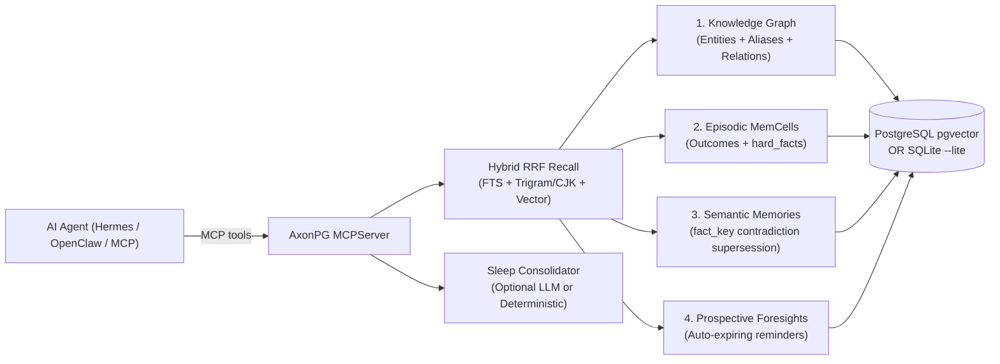

<div align="center">

# AxonPG

**Multilingual PostgreSQL-Native Cognitive Memory Engine for AI Agents**

[English](README.md) • [Español](docs/i18n/README.es.md) • [Português](docs/i18n/README.pt.md) • [Français](docs/i18n/README.fr.md)

[](https://github.com/ricardo2591/axonpg/actions/workflows/ci.yml)
[](LICENSE)
[](pyproject.toml)

</div>

---

AxonPG gives AI agents (such as **Hermes Agent**, **OpenClaw**, **Claude Desktop/Code**, **Cursor**, and **Antigravity**) durable, structured, **all-language** memory backed by a single **PostgreSQL + `pgvector` + `pg_trgm` + `unaccent`** instance — or an instant Zero-Docker **SQLite + FTS5 (`--lite`)** fallback for laptops and CI.

Instead of drowning LLM context windows with raw transcripts, AxonPG maintains **4 cognitive layers** while keeping exact facts (`IDs`, numbers, dates, currencies, error codes) lossless inside structured JSON (`hard_facts`):



## Why AxonPG?

- **True Multilingual Support (All Scripts)**: Uses Unicode NFC normalization, non-destructive accent folding (`camión` ↔ `camion`), PostgreSQL `'simple'` dictionary + `axon_unaccent`, SQLite FTS5 `unicode61`, substring matching for CJK (`日本語`, `中文`, `한국어`), Cyrillic, and Arabic, plus multilingual embeddings by default (`paraphrase-multilingual-MiniLM-L12-v2`).
- **One Database, Zero Stack Bloat**: Runs on a single PostgreSQL container (`pgvector/pgvector:pg16`) or zero-dependency `--lite` SQLite WAL database. No Neo4j, Qdrant, or Redis required.
- **Lossless `hard_facts` + Fact Supersession**: Updating a `fact_key` automatically marks older contradicting facts as `superseded_by`, while exact parameters inside `hard_facts` are never rounded or paraphrased.
- **Plug & Play Agent Setup (`axonpg init`)**: Interactive multilingual setup (`en`, `es`, `pt`, `fr`) with safe non-destructive MCP configuration for Hermes Agent, OpenClaw, and Generic MCP clients.
- **Multi-Provider Freedom**: Works offline on CPU (`fastembed` ONNX), locally (`ollama`), or via cloud APIs (`nvidia` NIM, `openrouter`, `gemini`, `openai`, `custom` OpenAI-compatible).

---

## Supported Agent Comparison (`axonpg init`)

| Agent | Integration Mode | What `axonpg init` Writes | Best For |
| --- | --- | --- | --- |
| **Hermes Agent** *(default)* | Full auto-setup | Merges `mcp_servers.axonpg` into `~/.hermes/config.yaml` + installs `~/.hermes/skills/axonpg-memory/SKILL.md` | Python-native workflows, skill evolution, token efficiency |
| **OpenClaw** | Schema-safe MCP bundle | Writes standalone `~/.openclaw/mcp/axonpg.json` + `~/.openclaw/skills/axonpg-memory/SKILL.md` (leaves strict `openclaw.json` untouched) | Node.js/TS multi-channel gateways & Control UI |
| **Generic MCP** | Standard `mcpServers` JSON | Generates `axonpg.mcp.json` ready for Claude Desktop, Cursor, Windsurf, or Antigravity | IDE coding assistants & desktop clients |

---

## Quickstart

### Option A: 1-Line Installer

**Linux / macOS:**
```bash
curl -fsSL https://raw.githubusercontent.com/ricardo2591/axonpg/main/installers/install.sh | bash
```

**Windows (PowerShell):**
```powershell
irm https://raw.githubusercontent.com/ricardo2591/axonpg/main/installers/install.ps1 | iex
```

### Option B: Manual Local Setup

```bash
git clone https://github.com/ricardo2591/axonpg.git
cd axonpg
python -m venv .venv
source .venv/bin/activate  # Windows PowerShell: .venv\Scripts\Activate.ps1
pip install -e ".[local]"
```

**Start PostgreSQL (`pgvector`):**
```bash
docker compose up -d
axonpg init --mode docker --agent hermes --lang en
axonpg doctor
```

**Or start in Zero-Docker `--lite` mode (instant laptop/CI mode):**
```bash
axonpg init --mode lite --agent hermes --embed-provider fastembed
axonpg doctor
```

---

## MCP Tools Exposed

When running `axonpg serve` over `stdio` or `streamable-http`, agents get 9 structured tools:

1. `memory_recall` — Token-budgeted hybrid recall across Knowledge Graph, Semantic Memories, Episodic Lessons, and Active Foresights.
2. `memory_upsert_entity` — Add or update entities with multilingual aliases and JSON properties.
3. `memory_add_relation` — Connect entities with weighted, temporally-bounded edges.
4. `memory_record_episode` — Log task execution outcomes (`success` / `failure` / `partial`) with exact `hard_facts`.
5. `memory_upsert_fact` — Store current truth; auto-supersedes outdated active facts sharing the same `fact_key`.
6. `memory_add_foresight` — Register deadlines/follow-ups with automatic `expires_at` archival.
7. `memory_complete_foresight` — Mark an active foresight as completed.
8. `memory_consolidate` — Run sleep-time synthesis of unconsolidated episodes (deterministic or LLM-assisted).
9. `memory_stats` — Inspect active counts per memory layer.

---

## Embedding & LLM Consolidation Providers

Configure in `.env` (never committed) or during `axonpg init`:

| Provider | Embeddings (`AXONPG_EMBED_PROVIDER`) | Consolidation LLM (`AXONPG_LLM_PROVIDER`) |
| --- | --- | --- |
| `fastembed` | `sentence-transformers/paraphrase-multilingual-MiniLM-L12-v2` (384d, local CPU) | — |
| `ollama` | `bge-m3` (1024d, local) | `qwen2.5:7b` (local) |
| `nvidia` | `baai/bge-m3` (1024d) | `meta/llama-3.1-70b-instruct` |
| `openrouter` | `openai/text-embedding-3-small` (1536d) | `meta-llama/llama-3.3-70b-instruct:free` |
| `gemini` | `gemini-embedding-001` (768d) | `gemini-2.5-flash` |
| `openai` | `text-embedding-3-small` (1536d) | `gpt-4o-mini` |
| `custom` | Any OpenAI `/v1/embeddings` endpoint | Any OpenAI `/v1/chat/completions` endpoint |
| `none` | Keyword/FTS/trigram fallback only | Deterministic offline consolidation (default) |

> **Security Note:** Generated agent configs (`hermes`, `openclaw`, `axonpg.mcp.json`) store **zero secrets**. They pass `AXONPG_ENV_FILE` pointing to your local `.env` file (`chmod 600` on POSIX).

## License

Apache License 2.0 — see [LICENSE](LICENSE).
